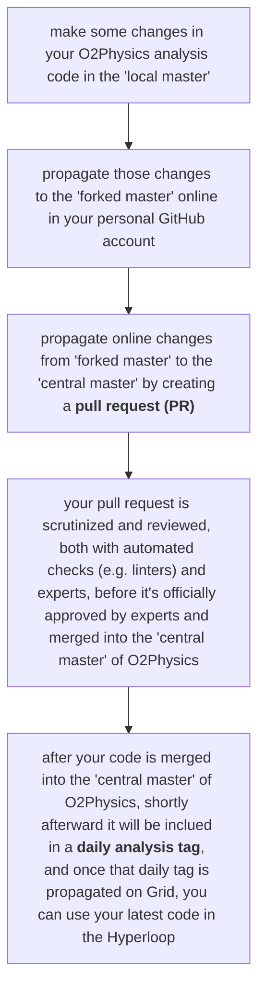

#  How to commit the local code to the central O2 repository?

**Last update**: 20261025-1

Here are the steps you need to follow to commit your code from the local O2Physics repository to the central O2Physics repository at [https://github.com/AliceO2Group/O2Physics](https://github.com/AliceO2Group/O2Physics).

The main point is that once your code is in the central O2Physics repository, and shortly afterward in one of the daily release tags, your code can be used to analyze large datasets online in Hyperloop. 

**Disclaimer #1:** Some of the steps below are needed only the very first time you commit your code. 

**Disclaimer #2:** In addition, some steps below can be optimized and further improved using **git** built-in functionalities, but the current version works and it's a straightforward starting point.


#### 1. Setting up the GitHub account
First, if you already do not have one, you need to create a [GitHub](https://github.com) account (ideally, using the same username you have at CERN, though that is not mandatory). 

After that, login into your GitHub account and authorize "ALICE Continuous Integration" to read your username so that it can be mapped to your CERN account (for more details, see the first two sections in [https://alisw.github.io/git-tutorial/](https://alisw.github.io/git-tutorial/).

On your computer where you are developing the code in the local O2Physics repository and where you can use **git**, adapt your credentials below and then execute:

```bash
git config --global user.name "First-name Last-name" 
git config --global user.email "your-CERN-email-address" 
git config --global user.github "your-GitHub-username"
```


#### 2. Forking
In this step, you will learn how to clone the central O2Physics repository on GitHub from this [link](https://github.com/AliceO2Group/O2Physics) into your own account on GitHub &mdash; this process is called _forking_.

a) Go to the central O2Physics repository on GitHub by following this [link](https://github.com/AliceO2Group/O2Physics);

b) Click on the 'Fork' in the top-right menu (you can click only if you are already logged in GitHub with your account &mdash; if not just click on the top menu on 'Sign in');

c) If forking went OK, now you shall be automatically redirected to your personal O2Physics repository on GitHub, something like [https://github.com/abilandz/O2Physics](https://github.com/abilandz/O2Physics) (adapt the username in this path to your own account, same comments applies wherever below you see 'abilandz'). This is your personal 'fork' of the central O2Physics repository at this [link](https://github.com/AliceO2Group/O2Physics);

d) At the time you 'forked' the central repository, your 'fork' is the 'master' branch version of the central O2Physics repository at that time. A few remarks:

* New changes in 'master' branch in the central O2Physics repository are NOT automatically propagated into your own 'fork' &mdash;  this is summarized online in your 'fork' with something like "_This branch is ... ahead and ... behind AliceO2Group/O2Physics:master_";

* The main point of having a 'fork' is the following: You can propagate changes from your local O2Physics repository directly into the online O2Physics repository, but only in your own 'fork' (certainly NOT directly into the central O2Physics repository); 

* Only when you want to propagate those local changes to the central O2Physics repository, a lot of automated checks will be performed on your new code, and a person in charge needs to review and approve your changes;

* In the browser, see if you want to bookmark your own 'fork', as you will be visiting this page frequently;

* If you have screwed-up your 'fork', or if your 'fork' is lagging too much behind the development in the central O2Physics repository at this [link](https://github.com/AliceO2Group/O2Physics), no worries, you can trivally always delete your 'fork', and make a new 'fork' again (or you can use built-in functionalities in **git** to synchronize (investigate this further by yourself if interested, but beware of potential merging conflicts which can be frequently a nightmare to fix). At least in the beginning, keep it simple and just delete your 'fork' and 'fork' it again, because this doesn't take much time &mdash; it' less than 1 min. To delete a 'fork', just go to your online 'fork', then click on 'Settings' (last item in the close-to-top horizontal menu), then scroll down to the 'Danger Zone' and opt for 'Delete this repository'. Then, simply go to Step 2a) above again. 

To synchronize the 'local master' version of O2Physics with the 'forked master' of O2Physics in your online account on GitHub, and in the next step to propagate those changes further to the 'central master', the typical/standard workflow during code development is the following:

<div align="center"> <!-- center the diagram below, do not forget to close it with </div> below -->



</div> <!-- closing the figure-centering env. opened above -->

How to establish the link between the 'forked master' online in GitHub, with the 'local master' (here I assume that you have checked out already on your local computer the 'master' branch of O2Physics, either directly, or e.g. with the shell function **InstallationO2**. To establish a link between 'local master' and online 'forked master', you do NOT need to recompile the 'local master' version from scratch &mdash; you can do something like this using the shell function **InstallationO2**:

```bash
InstallationO2_TopLevelBuildDir=someDirectory; InstallationO2_Compile=false; InstallationO2 master
```

This will checkout the 'central master' of O2Physics into local directory named 'someDirectory' (adapt further this directory and its name as necessary), but without compiling it.

Go now to the git repository of your O2Physics 'local master' (remember - you do NOT need to compile it from scratch, just check it out locally):

```bash
# use the same path as above:
cd someDirectory

# 'abilandz' here is my GitHub account name, replace with yours:
git remote add abilandz git@github.com:abilandz/O2Physics 
```

In order to cross-check if your 'local master' is now in sync  with the 'forked master' in GitHub, proceed as follows::

```bash
$ git remote -v
abilandz git@github.com:abilandz/O2Physics (fetch)
abilandz git@github.com:abilandz/O2Physics (push)
upstream https://github.com/AliceO2Group/O2Physics (fetch)
upstream https://github.com/AliceO2Group/O2Physics (push)
```

In the above printout, the first two lines point to  your personal online 'fork', and the last two lines point to the central O2Physics repository. If you have only the last two lines in the above printout, the previous step has failed.


#### 3. Setting up a passwordless login for GitHub using SSH
You need to perform this step if you do not want to type your password again and again when pushing local changes to GitHub from your terminal. To set up the password-less login to GitHub, follow these online instructions:

* [https://help.github.com/articles/checking-for-existing-ssh-keys/](https://help.github.com/articles/checking-for-existing-ssh-keys/) 
* [https://help.github.com/articles/generating-a-new-ssh-key-and-adding-it-to-the-ssh-agent/](https://help.github.com/articles/generating-a-new-ssh-key-and-adding-it-to-the-ssh-agent/) 
* [https://help.github.com/articles/adding-a-new-ssh-key-to-your-github-account/](https://help.github.com/articles/adding-a-new-ssh-key-to-your-github-account/)


#### 4. Propagating changes from 'local master' into 'forked master' on GitHub
If necessary, you can remind yourself about **git** by having a look at the first two sections of [https://nat3054-ws2627.onrender.com/git.html](https://nat3054-ws2627.onrender.com/git.html).

Do some change in your local working O2Physics repository where you are regularly developing your code. By default, modify locally ONLY your code, do NOT touch the code of other people in the O2Physics repository! After you have reviewed and validated your code in your working repository locally (this is the O2Physics repository which you regularly compile and use to do analysis locally), copy only the modified classes into a temporary git repository (named "someDirectory" in the Step 2b) above &mdash; remember, this one you do NOT compile, you just use it to propagate local changes to your online 'fork'):

After copying, simply do in the terminal (adapt "someDirectory" everywhere below to your case):

```bash
# go to O2Physics directory:
$ cd someDirectory/O2Physics

# execute this command to get a summary of all files which changed:
$ git status 
... list of modified files and corresponing 'git' summary ...

# stage the modified files:
$ git add someCode.cxx
$ git add someOtherCode.cxx
... some more modified files ...

# commit all files that you have staged at the previous step: 
$ git commit -m "some commit message summarizing current modifications" 

# finally, push your changes from 'local master' to 'forked master'
# on Grid (use your GitHub username below):
$ git push abilandz
```

After this step, changes are on your own 'forked master' on GitHub (check now with the browser the updated status of your 'fork' on GitHub!), and they are not yet upstream in the 'central master'' O2Physics repository on GitHub. This means they will not be included in the daily analysis tag, unless you do not perform the next and the final step, which is outlined in the next section.
                    
Only when for the very first time you are adding a new code to the central O2Physics repository, you also need to include in that commit the modified specific "CMakeLists.txt" file, i.e. you have to tell **cmake** that your newly included file in O2Physics repository also needs to be compiled. 

Recall from one of the previous tutorials the line below:

* copy the class "student-o2physics.cxx" into subdir ```path-to-your-local-working-repository/O2Physics/PWGCF/MultiparticleCorrelations/Tasks```

In the subdirectory of 'local master' ```someDirectory/O2Physics/PWGCF/MultiparticleCorrelations/Tasks``` there is a file "CMakeLists.txt" . Append the following lines end the end of that file:

```cmake
o2physics_add_dpl_workflow(student-o2physics
                    SOURCES student-o2physics.cxx
                    PUBLIC_LINK_LIBRARIES O2::Framework O2Physics::AnalysisCore O2Physics::PWGCFCore
                    COMPONENT_NAME Analysis)
```

By this point, think of a new name for your analysis task, i.e. you can rename "student-o2physics.cxx" into any other name you would prefer, and propagate that change in all other files. In case you have renamed your analysis task "student-o2physics.cxx" into some other file name, use that new name above in "CMakeLists.txt" as well. You have to modify and commit the modified "CMakeLists.txt" file only once, the first time you are adding your new code to the O2Physics repository. 


#### 5. Propagating changes from 'forked master' on GitHub into 'central master' on GitHub (a.k.a. 'New Pull Request')

To propagate your new code from 'forked master' into 'central master', simply go to your online 'fork' of O2Physics in GitHub, click 'Contribute', and then select 'Open Pull Request', and follow the tide.

After all automated checks in the 'central master' repository related to your pull request are successful, and after somebody in charge (the official reviewer) approves your pull request (PR), your code will be merged into the 'central master' of thel O2Physics repository, and it will be included automatically in the next daily analysis tag. This procedure can take easily more than 1 day, so you need to be patient. If any of the automated checks failed, you have to fix your code locally immediately, make and push a new commit, and that commit will be automatically included in the same pull request. 

In the end, the final email you shall receive shall contain the message like this: 

```Merged #13241 into master```

where 13241 is an example number of your pull request. This means that your new code is now officially included in the 'central master' of O2Physics on GitHub.

If your new code was included before 16:00, it will be included in the next daily analysis tag, and typically by 20:00 of the same day, it will be deployed on all worker nodes on Grid. <span style="color: red;">TBI 20261025 cross-check if these time constraints still apply</span>

Finally, after this point, you can also use your latest code on Hyperloop. 


