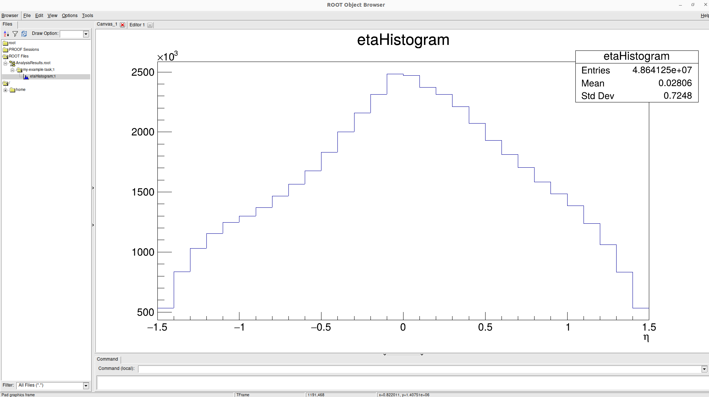

# Local installation
**Last update**: 20261025-1


To install locally the O2 analysis software, the **Bash** shell utility function **InstallationO2** can be used. That function is implemented, alongside other O2 utility functions in this personalized [O2Tutorial](https://github.com/abilandz/O2Tutorial) repository, and the latest version of the code can be obtained directly by following this direct link [O2.sh](https://github.com/abilandz/O2Tutorial/blob/gh-pages/src/scripts/O2.sh). 


#### 1. Prerequirements: aliBuild
The utility function **InstallationO2** is basically a down-to-earth wrapper for **aliBuild**, the highly-sophisticated Python script which is doing the actual O2 compilation. Therefore, one first has to ensure that **aliBuild** is installed, by using:

```bash
$ sudo pip install alibuild
```
Later, **aliBuild** can be upgraded to a newer version with:

```bash
$ sudo pip install alibuild --upgrade
```
All the steps from this tutorial were last time succesfully performed on Linux Ubuntu 22.04, using **aliBuild** version 1.17.48:
```bash
$ aliBuild version
aliBuild version: 1.17.48 (ubuntu2204_x86-64)
```


#### 2. Installation via shell's utility functions
To use install locally O2, follow these steps:

1. copy locally and source the file "O2.sh" 

      ```bash
      $ source O2.sh
      ```

      After this step, shell utility functions **InstallationO2**, **MenuO2**, etc., are in a computer's memory, and can be used like any other Linux or shell command.

2. print the example use cases of **InstallationO2**

      ```bash
      $ InstallationO2 -h
      Example use cases:
       # Example 1: InstallationO2 master # compiles package O2Physics@master in default top level build directory

       # Example 2: InstallationO2 nightly-20220630 # compiles package O2Physics@nightly-20220630 in default top level build directory

       # Example 3: InstallationO2_TopLevelBuildDir=$HOME/scratch/aliceO2-1; InstallationO2 master 
                    # Compiles package O2Physics@master in user specified top level build directory,
                    # using default value hardwired for each machine for number of jobs (e.g. 16 for 'anteb', 8 for 'napalm', 12 for 'nx*' etc.) 

       # Example 4: InstallationO2_TopLevelBuildDir=$HOME/scratch/aliceO2-1; InstallationO2_nJobs=12; InstallationO2 master 
                    # Compiles package O2Physics@master in user specified top level build directory, using 12 nJobs as an argument to -j flag of aliBuild. 

       # Example 5: InstallationO2_TopLevelBuildDir=$HOME/scratch/aliceO2-1; InstallationO2_Compile=false; InstallationO2 master 
                    # Only checks out package O2Physics@master in user specified top level build directory, i.e. compilation is NOT performed
      ```

	As the above examples illustrate, the shell function **InstallationO2** configures itself from pre-defined variables. The default values of variables are hardcoded in its source code, and those internal default settings can be overwritten by defining in the current shell environment the following variables:
	
	* **InstallationO2_TopLevelBuildDir** &mdash; this is a top-level directory on a local computer into which the whole O2 software will be compiled;
	* **InstallationO2_nJobs** &mdash; the total number of CPU cores which will be used during compilation. One can use more CPUs to speed up compilation, but that will cause more stress on the system due to larger memory consumption. We would suggest to start with 4 CPUs, and if the compilation fails due to large memory consumption, simply restart compilation, but with smaller number of CPUs (see further tips below);
	* **InstallationO2_Compile** &mdash; if you set this varible to ```false```, the O2 source code will only be copied locally, but the compilation won't start. 

	Besides that, the function **InstallationO2** can take one argument, which determines the version of O2 software which one wants to install locally. As a rule of thumb, that shall be the "master" branch. 

3. In case you want to compile the "master" version of O2 in a local directory ```$HOME/aliceO2-1/``` (or adapt to any other path), using 4 CPUs, simply execute in the terminal:
	```bash
	$ InstallationO2_TopLevelBuildDir=$HOME/aliceO2-1
    $ InstallationO2_nJobs=4
    $ InstallationO2 master 
	```
	or instead and equivalently a one-liner:
	```bash
	$ InstallationO2_TopLevelBuildDir=$HOME/aliceO2-1; InstallationO2_nJobs=4; InstallationO2 master 
	```
	For any subsequent installation from scratch of O2, one can simply increase the "build counter" in the directory name "aliceO2-1".

4. In case the O2 compilation failed due to large memory consumption, in the very same terminal you can try to restart the compilation with smaller number of CPUs. Using the above settings, you can restart the failed compilation in the same terminal manually with:
    ```bash
    # navigate to the top-level build directory:
    $ cd $HOME/aliceO2-1
    
    # restart manually compilation with smaller number of CPUs:
    $ aliBuild build O2Physics -j 3 --defaults o2 --debug 2>&1 | tee build.log
    ```
    The option ```-j``` takes number of CPUs as its argument. The Linux command **tee** is used to redirect all printed information during compilation to the monitor, and in parallel to the file "build.log". If the above compilation fails as well due to large memory compilation, the compilation can be restarted again with even less CPUs. 

5. In case the O2 compilation succeded, you shall get a message like this in the terminal: 

    ```bash
    Build of O2Physics successfully completed on `napalm'.
    Your software installation is at:
	
    /home/abilandz/aliceO2-1/sw/ubuntu2204_x86-64
	
    You can use this package by loading the environment:
	
    alienv enter O2Physics/latest-master-o2
    Build directory for devel package O2:
    /home/abilandz/aliceO2-1/sw/BUILD/O2-latest-master/O2
    Build directory for devel package O2Physics:
    /home/abilandz/aliceO2-1/sw/BUILD/O2Physics-latest-master/O2Physics
    2026-07-02@11:34:21:DEBUG:O2Physics:O2Physics:master: Everything done
    ```
	To faciliate the procedure, to load and enable the environment from scratch for this O2 build in another terminal, the utility function **MenuO2** is provided (it's implemented in the same file, namely  [O2.sh](https://github.com/abilandz/O2Tutorial/blob/gh-pages/src/scripts/O2.sh), as **InstallationO2**). This shell function **MenuO2** is just a wrapper for **alien enter ...** command above. 


6. Open a new terminal, and initialize locally the O2 environment for its build in ```${HOME}/aliceO2-1```, using shell function **MenuO2**:
    ```bash
    # source the implementation of MenuO2:
    $ source O2.sh
    
    # Tell MenuO2 for which O2 build you want to initialize env.:
    $ MenuO2_TopLevelBuildDir=${HOME}/aliceO2-1
    
    # Finally, execute MenuO2:
    $ MenuO2
    ```
	You will be prompted with a small menu, e.g. choose "master" version of O2 built in ```${HOME}/aliceO2-1``` 

	After that, the function **MenuO2** will initialize the environment for this O2 built. You still have to execute:
    ```bash
    $ bash
    ```
    to start a new shell instance, where only global variables are inherited and shell configuration files are sourced from scratch. This is an important step, and shall not be overlooked.

After this final step, you have the working O2 installation in your current terminal, and can proceed with the next quick check.


#### 3. The elementary out-of-box tutorial example
Process one example "AO2D.root" file with your current O2 installation, using the tutorial executable **o2-analysistutorial-mm-my-example-task**. As an example, we will process with that executable one example "AO2D.root" from Pb&ndash;Pb collisions in 2023, from the latest available reconstruction pass (apass5). You can download one such file directly from AliEn catalogue into your current working directory, by using:

```bash
$ alien.py cp /alice/data/2023/LHC23zzh/544122/apass5/0440/o2_ctf_run00544122_orbit0157342304_tf0000666602_epn334/001/AO2D.root file:.

jobID: 1/1 >>> Start
jobID: 1/1 >>> STATUS OK >>> SPEED 108.14 MiB/s
Successful jobs (1st try): 1/1
```

With the command **alien.py cp**, the example "AO2D.root" file of 2023 data-taking period LHC23zzh, from run number 544122 and the 5th reconstruction pass, is copied into current working directory (in case you want to copy that file from AliEn catalogue directly to some other location locally, simply adapt the last argument ```file:.``` with ```file:someOtherDir```).

After you have copied the example file "AO2D.root" from AliEn catalogue locally, execute:
```bash
$ o2-analysistutorial-mm-my-example-task --aod-file AO2D-data.root
```

The above line assumes that the file "AO2D.root" is in your current working directory &mdash; if it's not, adapt above either its relative or absolute path.

You shall see on the screen something like:
```bash
$ o2-analysistutorial-mm-my-example-task --aod-file AO2D.root 
[INFO] Loading metadata from file AO2D.root in PID 425933
[INFO] Metadata for file "AO2D.root":
[INFO] - O2Version: 1.2.0
[INFO] - LPMProductionTag: LHC23zzh
[INFO] - ROOTVersion: 6.32.06
[INFO] - RecoPassName: apass5
[INFO] - Run: 3
[INFO] - AnchorPassName: 
[INFO] - DataType: RAW
[INFO] - AnchorProduction: 
[INFO] Initialising O2 Data Processing Layer. Driver PID: 425933.
[INFO] Driver listening on port: 14013

... many more lines not shown here ...

[425966:internal-dpl-clock]: [13:33:08][STATE] Exiting FairMQ state machine
[INFO] ## Processes completed. Run summary:
[INFO] ### Devices started: 6
[INFO]  - Device internal-dpl-clock: pid 425966 (exit 0)
[INFO]  - Device internal-dpl-aod-reader: pid 425967 (exit 0)
[INFO]  - Device internal-dpl-aod-spawner: pid 425968 (exit 0)
[INFO]  - Device my-example-task: pid 425969 (exit 0)
[INFO]  - Device internal-dpl-aod-global-analysis-file-sink: pid 425970 (exit 0)
[INFO]  - Device internal-dpl-injected-dummy-sink: pid 425971 (exit 0)
[INFO] ## Analysis Run Summary ##
[INFO] ### Files read stats ###
[INFO] lfn=AO2D.root,size=4007126220,total_df=83,read_bytes=942195916,read_calls=420,io_time=2.6,wait_time=0.8,level=0,read_df=83,skipped_df=0
[INFO] ### Files opened stats ###
[INFO] Last file opened: lfn=AO2D.root,size=4007126220
[INFO] Dumping used configuration in dpl-config.json
```

As an output of this processing, you shall get the output analysis file named "AnalysisResults.root", holding a histogram with example eta distribution, produced by the executable **o2-analysistutorial-mm-my-example-task**, as the following screenshot demonstrates.



<!-- TBI 20261025: Since in this repo I support only about MkDocs "material", I used above the specific relative path ../Figures . See NAT3054 repository, if I want to generalize  --> 
